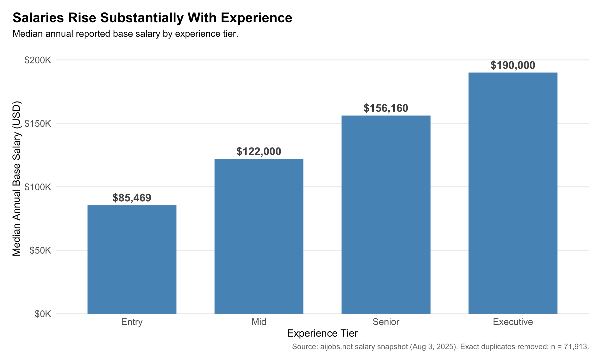
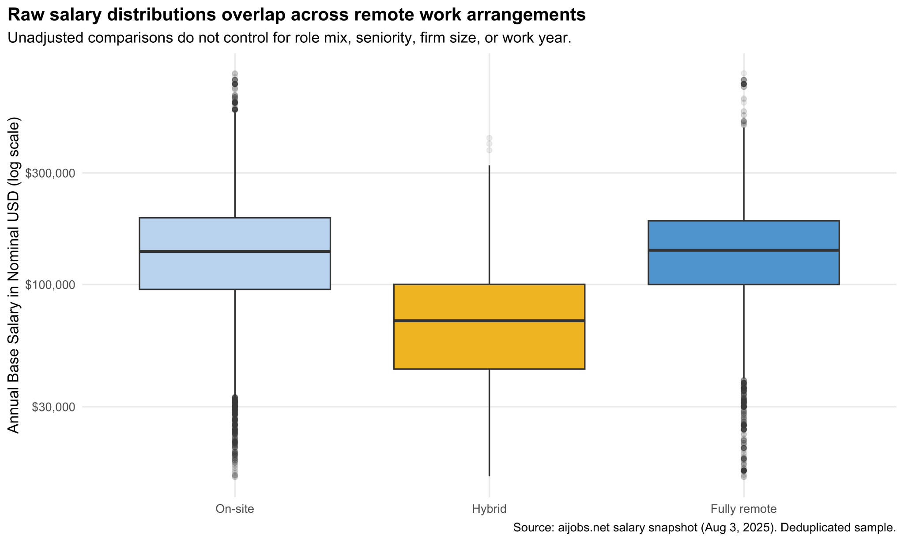

# Global Data & AI Workforce Compensation Analytics

**Exploratory compensation analysis · R / Quarto · Collaborative course project (2026)**

[**Interactive dashboard ↗**](https://4e3w5f-gaku-aihara.shinyapps.io/Libeccio_Career_Dashboard/) · [**Reproducible analysis**](analysis.qmd)

## Overview

This project analyzes self-reported **Data Science and AI salaries** to explore how reported annual base pay varies with **experience level**, **technical role family**, **employer size**, and **remote-work arrangement**. The team also translated the analysis into a hypothetical executive-search consulting pitch, using **Walmart Global Tech** as an illustrative potential client—not a current client or an employer identifiable in the dataset.

The course-supplied snapshot contained **151,445 rows** covering reported work years **2020–2025**. After removing **exactly identical rows**, the analysis uses **71,913 distinct records**. The source does not include respondent identifiers, so this processing decision is a modeling choice rather than proof that every repeated row represents the same person.

## Questions explored

- How do reported salary levels differ between **Entry**, **Mid**, **Senior**, and **Executive** roles?
- Is fully remote status **associated with** a pay premium or penalty after accounting for role family, seniority, firm size, and work year?
- How do salary distributions and cross-sectional year comparisons differ across technical specialties and employer sizes?

## Selected findings

| Topic | Result | Interpretation |
| --- | --- | --- |
| Experience | Median annual base pay generally increases across seniority categories. | Descriptive differences between worker groups, **not individual raises**. |
| Remote status | Adjusted fully remote coefficient corresponds to approximately **−0.7%** relative to on-site (**p = 0.141**). | No statistically detectable difference in this model; **not proof of equal pay**. |
| Role specialties | Machine Learning / AI, technical leadership, and software/platform engineering show comparatively high reported salary benchmarks. | Based on keyword-classified job titles; results vary by role mix. |
| Employer size and year | Salary patterns vary across firm sizes and between the 2024 and partial-2025 snapshots. | The sample is highly concentrated in medium-sized firms; 2025 is incomplete. |

## Visualizations

A selection of original figures from the project is shown below. **[Explore all nine figures →](figures/README.md)** for salary progression, distributions, outliers, technical role comparisons, and partial-year trends.

### Experience-tier medians



Different experience categories represent distinct worker groups rather than observed salary raises for the same employees.

### Remote-work salary distributions



These descriptive distributions are unadjusted; the regression analysis is documented separately in the [Quarto report](analysis.qmd).

## Methods and tools

**R**, **tidyverse / dplyr**, **ggplot2**, **Quarto**, **linear regression**, and an interactive **Shiny** dashboard.

The reproducible report covers an exact-row-duplicate audit; data quality and geographic summaries; role-family classification; salary medians, IQRs, log-scale boxplots, and heatmaps; comparisons by career stage; and a log-linear regression for remote salary association. The hosted dashboard adds interactive filtering and pay-band exploration. **Its Shiny source code was not provided with these project files, so this repository links to the deployed app rather than claiming to include its code.**

## Reproduce the report

1. Install [R](https://cran.r-project.org/) and [Quarto](https://quarto.org/docs/get-started/).
2. From the repository root, install R dependencies:
   ```bash
   Rscript scripts/install_packages.R
   ```
3. Render the analysis:
   ```bash
   quarto render analysis.qmd --to html
   ```
4. Open the generated `analysis.html` in your browser.

The exact frozen dataset used for this project is included as [`data/salaries.csv.gz`](data/salaries.csv.gz) (151,445 records, compressed to under 1 MB). **The report loads this local file first**, so the data are available without an external download. The original snapshot is from [aijobs.net's salary dataset](https://github.com/foorilla/ai-jobs-net-salaries), published under [CC0](https://github.com/foorilla/ai-jobs-net-salaries/blob/main/LICENSE). See the [data provenance and limitations](data/README.md).

> **Reproducibility note:** This portfolio packaging was statically checked, but I could not run a full R/Quarto render in the preparation environment. Rendering requires R/Quarto and the listed packages; the source salary dataset is already included in this repository.

## Repository guide

| File | Description |
| --- | --- |
| [`analysis.qmd`](analysis.qmd) | Edited public-facing version of the group's Quarto report, with source analysis and charts |
| [`data/salaries.csv.gz`](data/salaries.csv.gz) | Original frozen salary snapshot (CC0) |\n| [`data/README.md`](data/README.md) | Data provenance, field definitions, and limitations |
| [`scripts/install_packages.R`](scripts/install_packages.R) | Required R packages |

## Team and attribution

**Gaku Aihara · Emily Wang · Snehil Rayal**  
Team Libeccio, 2026 — collaborative academic project.

The report and slides were jointly produced for a data visualization assignment. The materials do not distinguish each person's individual code contributions, so none are assigned here. This portfolio version retains all three names; the revised presentation will be added separately.

The published Quarto report includes editorial cleanups and more cautious interpretations; the original team presentation is not included in this repository pending collaborator review. A separate software license is **not** granted here. Before publishing shared slides or code, confirm your collaborators are comfortable with their public release, especially any photographs appearing in the presentation.

## Important limitations

The data are self-reported, **not** a representative sample of jobs or hiring demand. The source lacks employer names, verified respondent IDs, city-level location, and total compensation. The high fraction of identical rows makes the deduplication choice consequential. Company-size groups are highly imbalanced, cross-border records are sparse, and 2025 covers only a partial year. The regression measures an adjusted association, not causation, and does not demonstrate salary equivalence. The Walmart example is an **illustrative proposal**, not evidence of a recruitment engagement.