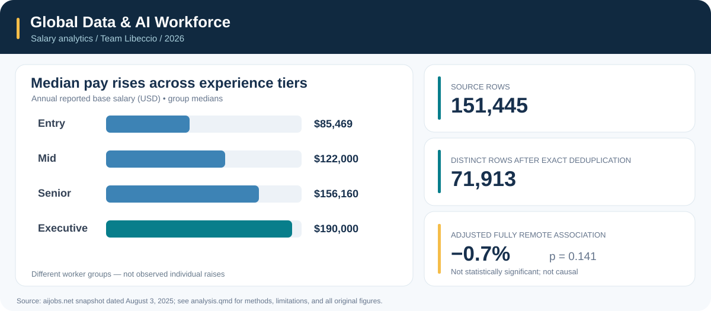

# Visualizations

A selection of nine original charts from Team Libeccio's compensation analytics project. The full-size images are included in the [downloadable figure archive](https://github.com/gakuaihara16/global-data-ai-compensation) only after the nine JPG files have been uploaded to this folder. Until then, the original plots can be regenerated from [`analysis.qmd`](../analysis.qmd).

## Career progression

| Visualization | What it illustrates |
| --- | --- |
| **Median salary by experience** | Entry-to-executive differences in reported annual base pay |
| **Career progression by technical specialty** | Salary levels across six technical role families |
| **Employer size × experience heatmap** | Differences in median salaries by firm size and seniority |
| **Adjacent career-tier differences** | Differences between group medians, not raises earned by individuals |

## Compensation distributions

| Visualization | What it illustrates |
| --- | --- |
| **Remote-work salary distributions** | Unadjusted reported salary variation across work arrangements |
| **Extreme compensation outliers** | Log-scale distributions and the $500,000 benchmark |
| **Experience-tier boxplots** | Variation in pay within experience categories |
| **Role-family representation** | Proportion of classified records in each specialty |

## Salary trends

| Visualization | What it illustrates |
| --- | --- |
| **2024 vs. partial 2025** | Descriptive role-family comparisons; 2025 is not a complete year |

## Figure files

The high-resolution chart images are in a separate nine-JPG package, ready to upload to this `figures/` directory. Once uploaded, the gallery can be replaced with thumbnail images and enlarged previews. The original slide-deck PDF will be added after the team's final edits.

**Attribution:** Gaku Aihara, Emily Wang, and Snehil Rayal — Team Libeccio (2026). Data from an aijobs.net salary snapshot dated August 3, 2025.

**Caution:** These are self-reported, nonrepresentative salary observations. Exact deduplication does not establish unique individuals, and cross-sectional differences are not individual salary growth.

[Back to project overview](../README.md) · [View analysis code](../analysis.qmd)
