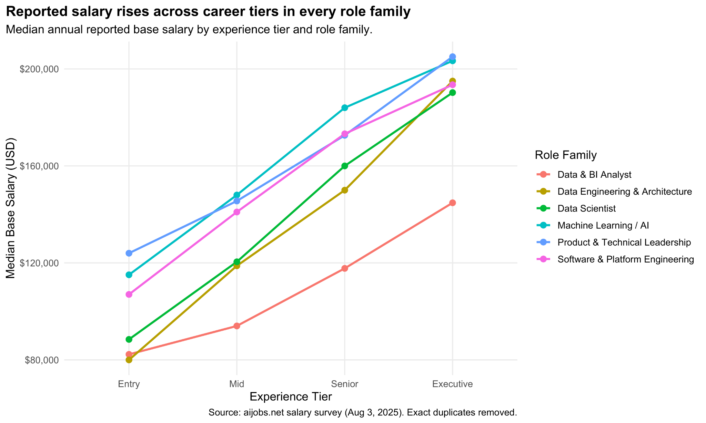
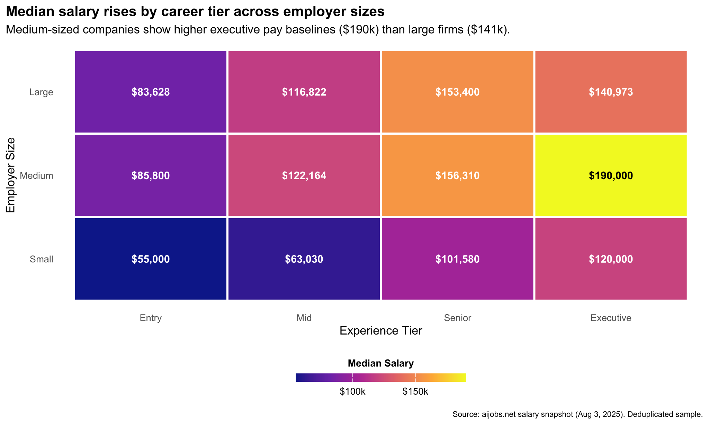
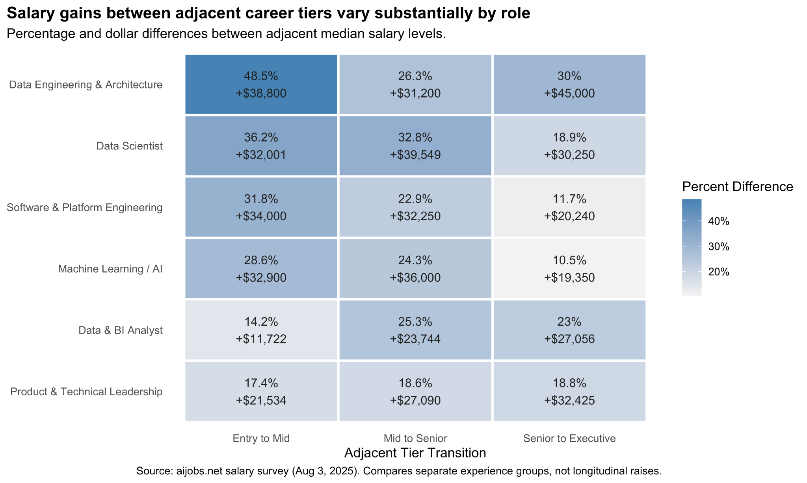
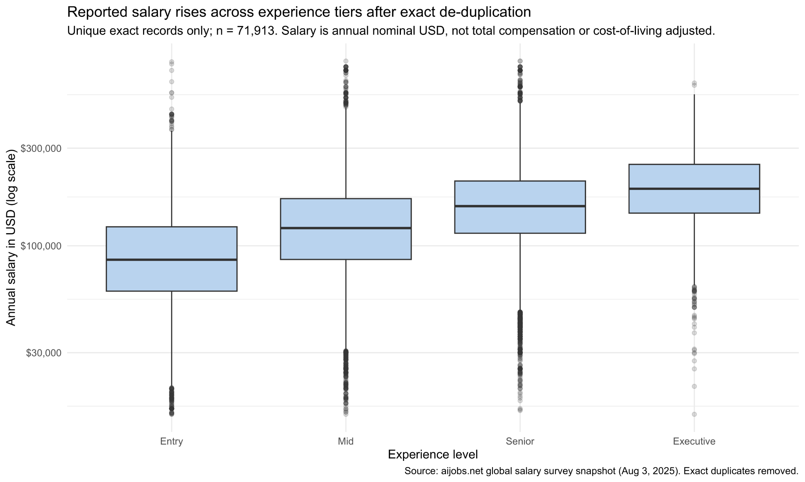
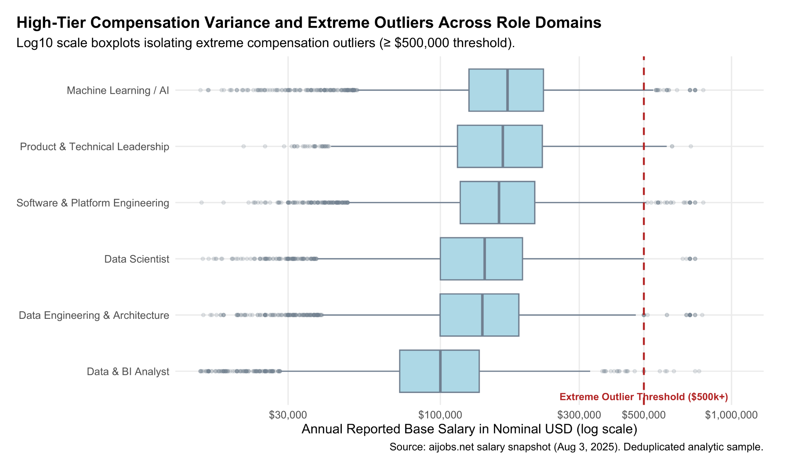
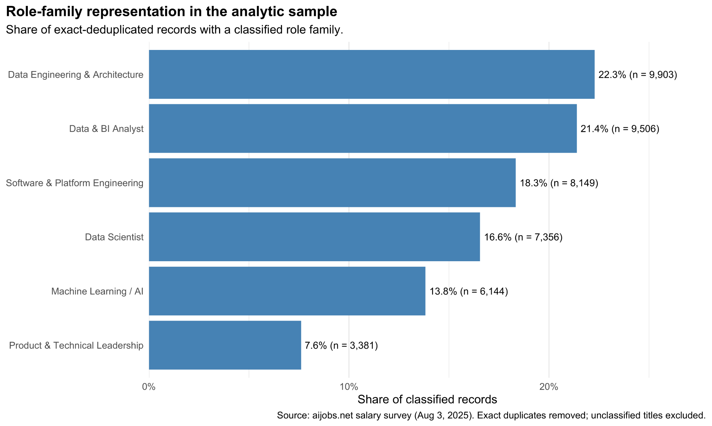
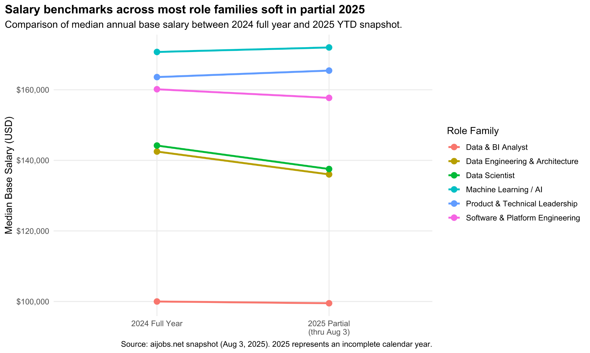

# Project Visualizations

These are the **nine original PNG charts**, organized without editing or redrawing them. Select any image to view it at full resolution. All were created for the collaborative Team Libeccio data visualization project.

## 1. Career progression and compensation

<table>
<tr><td width="50%" valign="top">

<strong>Median salary by experience</strong>

A comparison of median reported base salaries from Entry ($85,469) through Executive ($190,000). These are different experience groups, not tracked employee raises.

</td><td width="50%" valign="top">

<strong>Career progression by technical role</strong>

A line chart of median salaries across experience tiers for six technical role families; ML/AI and technical leadership report comparatively high pay at senior tiers.

</td></tr>
<tr><td width="50%" valign="top">

<strong>Experience and company size</strong>

A heatmap of median annual salaries by company size and seniority. Medium-sized firms show a $190,000 executive median in this sample.

</td><td width="50%" valign="top">

<strong>Differences between career tiers</strong>

Percentage and dollar gaps between adjacent experience-tier medians for each role family. These are cross-sectional differences, not individuals' actual raises.

</td></tr>
</table>

## 2. Salary distributions and sample composition

<table>
<tr><td width="50%" valign="top">

<strong>Salary variation by experience</strong>

Log-scale boxplots illustrate median pay, variability, and extreme observations within each of the four experience groups.

</td><td width="50%" valign="top">

<strong>Remote versus on-site distributions</strong>

Unadjusted log-scale boxplots compare on-site, hybrid, and fully remote salary observations. The regression in the report separately adjusts for job mix and other factors.

</td></tr>
<tr><td width="50%" valign="top">

<strong>Compensation outliers across roles</strong>

Log-scale boxplots compare salary dispersion across role families and mark the $500,000 extreme-outlier threshold.

</td><td width="50%" valign="top">

<strong>Composition of classified roles</strong>

The distribution of records classified into six technical role families, with Data Engineering & Architecture at 22.3% of classified records.

</td></tr>
</table>

## 3. Year-over-year comparison

<table>
<tr><td width="50%" valign="top">

<strong>2024 versus partial 2025</strong>

Role-family median pay in 2024 versus the 2025 snapshot through August 3; the incomplete 2025 coverage limits interpretations of salary growth.

</td><td width="50%"></td></tr>
</table>

## Notes

- **Source:** aijobs.net salary survey snapshot dated August 3, 2025. The original dataset contained 151,445 rows; exact-row deduplication retained 71,913 distinct records.
- **Interpretation:** salary comparisons across experience tiers represent differences between groups, not longitudinal changes in individual workers' salaries.
- **Measurement:** reported nominal annual base salary in USD; not a measure of total compensation or adjusted purchasing power.
- **Coverage:** the 2025 snapshot is a partial calendar year. The adjusted remote-work regression and limitations appear in the Quarto report.

**Creators:** Gaku Aihara, Emily Wang, and Snehil Rayal (Team Libeccio, 2026).

[← Project overview](../README.md) · [Analysis code](../analysis.qmd) · [Interactive Shiny dashboard ↗](https://4e3w5f-gaku-aihara.shinyapps.io/Libeccio_Career_Dashboard/)
